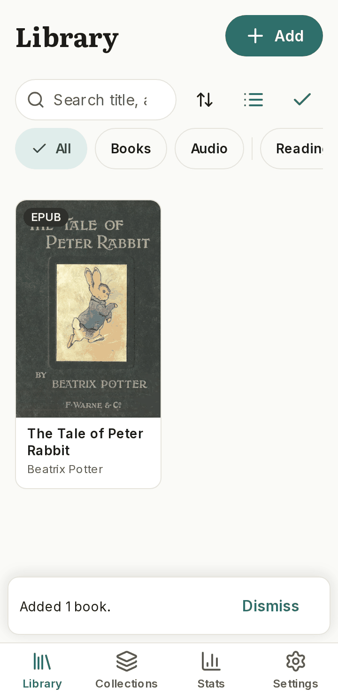

# PageNest

Free, installable, **offline-first** web app (PWA) for reading e-books and PDFs and listening to audiobooks — with background playback, read-aloud, expressive narration, and Voice Studio (your own voice only).

- **No login, no ads, no analytics, no payments, no backend.**
- Your files and your voice stay on your device.
- **[MIT licensed](LICENSE)** — use, fork, and ship freely; respect third-party licenses for bundled fonts and models ([docs/LICENSES.md](docs/LICENSES.md)).

The full specification is [docs/BLUEPRINT.md](docs/BLUEPRINT.md). Progress is tracked in [STATUS.md](STATUS.md) and design decisions in [DECISIONS.md](DECISIONS.md).

> **Live preview:** [pagenest-42f.pages.dev](https://pagenest-42f.pages.dev) on Cloudflare Pages (free plan). See [STATUS.md](STATUS.md) and [docs/DEPLOY.md](docs/DEPLOY.md).

## Launch prep (docs)

| Doc | Purpose |
| --- | --- |
| [docs/NAME_CHECK.md](docs/NAME_CHECK.md) | “PageNest” clearance notes and rename candidates |
| [docs/FEEDBACK.md](docs/FEEDBACK.md) | 5-question friend form + facilitator script |
| [docs/LAUNCH_CHECKLIST.md](docs/LAUNCH_CHECKLIST.md) | iPhone/Android PWA, offline, import, narration, audio |
| [docs/STORE_SCREENSHOTS.md](docs/STORE_SCREENSHOTS.md) | Store-style screenshot list and captions |

## Install (as a user)

1. Open [pagenest-42f.pages.dev](https://pagenest-42f.pages.dev) in your phone or desktop browser.
2. **Android / Chrome:** tap **Install**. **iPhone / Safari:** Share → **Add to Home Screen**.
3. Launch from your home screen. After the first load, core library and reading work **offline**.

## Store-style screenshots

Curated PNGs for README, install help, and future store listings:

- **Primary set (integrate-2, 360×740):** [docs/screens/integrate-2/](docs/screens/integrate-2/) — onboarding, library, reader, collections, settings, stats.
- **Audio / player:** [docs/screens/audio/](docs/screens/audio/) — full and mini player, multiple themes and widths.
- **Ordered carousel and captions:** [docs/STORE_SCREENSHOTS.md](docs/STORE_SCREENSHOTS.md).

Example (library with sample book):



## Run locally (as a developer)

Requirements: Node.js 20+, npm 10+, git.

```bash
git clone https://github.com/Mukesh-RM/pagenest.git
cd pagenest
npm install
npx playwright install --with-deps   # first time (or npm run playwright:install)
npm run dev        # Vite dev server
npm run build      # production build → dist/
npm test           # unit tests (Vitest)
npm run test:e2e   # Playwright (ports in docs/TESTING.md)
```

## Repository layout

```
src/
  app/          shell, routes, theme provider, install prompt
  ui/           design system
  features/     library, reader, player, narration, voice-studio, stats, settings
  engines/      pdf, epub, audio, tts, emotion
  data/         dexie schema, opfs files, backup and restore
  workers/      import, search, tts-render, audio-metadata
  sw/           service worker and update flow
tests/          unit and end-to-end tests
docs/           blueprint, launch checklists, screenshots
```

## Contributing rules

Conventional commits (`feat:`, `fix:`, `test:`, `docs:`, `chore:`). No secrets, model files, or personal data in the repo. See [.cursor/rules/pagenest.mdc](.cursor/rules/pagenest.mdc).

## License

[MIT](LICENSE)
