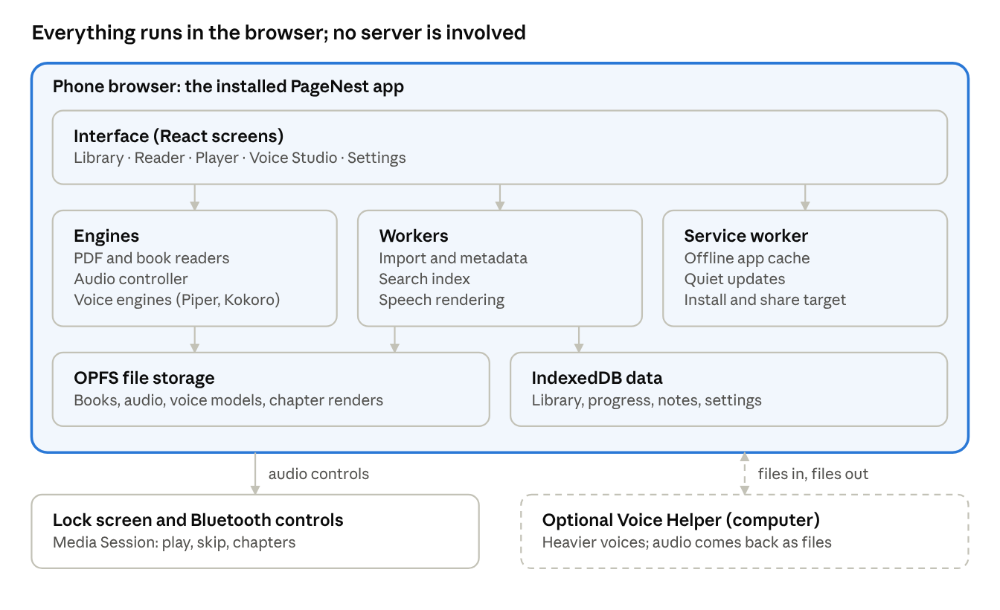
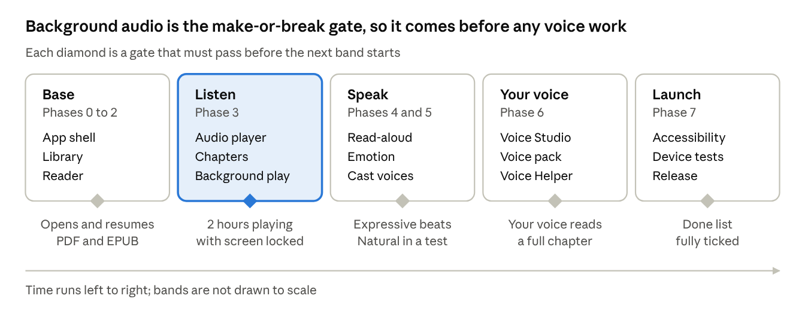

# InkQuiet: Free Reader and Audiobook Web App

Oct 24, 2026 · @dzx

InkQuiet is a free web app you install from a link onto your home screen. It opens e-books, PDFs and audiobooks, reads any book aloud in an expressive voice (even your own cloned voice), keeps playing with the screen off, works fully offline, and never asks you to log in. This document is the complete build blueprint: what the product is, how it looks and feels, how every feature works, how it is built, and the exact prompts to build it with Cursor or Claude.

## 1. What We Are Building


| InkQuiet is | InkQuiet is not |
|---|---|
| A web app (PWA) you open from a link and add to your home screen | A native app from Google Play or the App Store |
| Free: no ads, no subscription, no locked premium tier | A product with features hidden behind payment |
| Login-free: no account, no email, no password | Something that needs a server, a database of users or a profile |
| Offline: books, audio and voices are stored on your device | Dependent on the internet after the first install |
| One library for e-books, PDFs, documents and audiobooks | A bookstore; it never sells, hosts or bundles books |
| Private: your files and your voice never leave the device | A tracker: no analytics, no ads, no profiling |


## 2. Ten Promises to the User

1. **Two-tap install.** Open the link, tap Install (Android) or Add to Home Screen (iPhone). It then looks and launches like an app.
2. **Instant reading.** A PDF or EPUB opens in under 1.5 seconds and returns to the exact page after you close it.
3. **Real audiobook player.** MP3, M4B, M4A, OGG, OPUS and FLAC, with chapters, speed control, bookmarks and a sleep timer.
4. **Background playback.** Audio keeps playing with the screen locked, with lock-screen and Bluetooth controls.
5. **Read any book aloud.** Offline voices read e-books to you, also in the background.
6. **Voice that acts.** Calm narration, tense scenes, whispered and shouted dialogue, different voices for different characters.
7. **Your own voice.** Record a short guided sample in Voice Studio and hear books in your voice (your own voice only).
8. **Beautiful and calm.** A design made for hours of comfortable reading, one-handed use and dark rooms.
9. **Free and private.** No login, no ads, no tracking, no cost, no server.
10. **Yours to keep.** Back up the whole library, progress and voices to one file and restore it anywhere.

## 3. Who Uses It


| Person | What they want | What InkQuiet gives them |
|---|---|---|
| Commuter | Long audiobooks with the phone in a pocket | Background playback, lock-screen controls, sleep timer, exact resume |
| Student | PDFs and notes they can mark up and search | Fast PDF reader, highlights, notes, in-book search, export |
| Night reader | Comfortable reading in bed | Sepia, Dark and Black themes, warm filter, swipe-to-dim |
| E-book owner without the audiobook | To listen instead of read | Offline read-aloud with expressive voices |
| Someone who wants a personal touch | To hear a book in their own voice | Voice Studio with a clear consent flow |
| Someone on a shared or budget phone | No accounts and no fees | Zero login, zero cost, everything stays on the device |


## 4. Principles and Non-Goals

Principles

- **Content first.** The interface disappears while reading or listening.
- **Offline first.** Every feature works without internet after install, except the first load.
- **Fast.** Every action responds within 100 ms; screens never block on heavy work.
- **Private by design.** No server means nothing to leak.
- **Honest about limits.** Where a browser cannot do something, the app says so plainly and offers the best alternative.
- **Open licenses only.** Every library, font and voice model must allow free distribution.

Non-goals for version 1

- No accounts, cloud sync, social features or reviews.
- No book store, no bundled books, no DRM removal. Protected files show a clear message.
- No native Android or iOS app (a store wrapper stays possible later).
- No paid voice services; the voice stack runs on the device or the user’s own computer.

## 5. Design System and UI/UX

The look is calm, warm and quiet, like a well-made paperback: one accent color, generous space, soft motion, and controls that sit where a thumb rests. The reading and listening surfaces are sacred; everything else steps aside.

### 5.1 Design principles

- **Thumb first.** Primary actions live in the lower half of the screen; the top bar only holds back, title and menus.
- **One screen, one job.** Library browses, reader reads, player plays. No crowded dashboards.
- **Show progress everywhere.** Every cover carries a thin progress bar so you always know where you are.
- **Quiet by default, deep on demand.** Simple defaults; fonts, spacing, voices and effects sit one tap away in sheets.
- **No dead ends.** Every empty or error state says what happened and offers one clear next step.

### 5.2 Color themes


| Theme | Page | Text | Accent | Best for |
|---|---|---|---|---|
| Light | #FAFAF7 | #1C1B19 | #3E5BDB | Daytime and bright rooms |
| Sepia | #F4ECD8 | #3B2F23 | #A0522D | Long reading with low eye strain |
| Dark | #17181C | #E4E2DC | #8FA6FF | Evenings |
| Black | #000000 | #CFCDC7 | #8FA6FF | OLED screens, night, battery saving |
| Custom | You pick | You pick | You pick | Personal taste, saved as a preset |


The app theme follows the system setting by default and can be fixed in Settings. The reader theme is separate, so the library can stay dark while a book is sepia. All text meets WCAG AA contrast (4.5:1 or better).

### 5.3 Typography

- **Interface:** Inter (variable font, self-hosted), sizes 12, 14, 16, 20, 28.
- **Reading fonts (bundled, open license):** Literata, Source Serif, Merriweather, Lora, Atkinson Hyperlegible, OpenDyslexic, plus the device’s system serif and sans. Users can also import their own font file.
- **Reader controls:** size 12 to 40 px, line height 1.2 to 2.0, paragraph spacing, margins (narrow, normal, wide), alignment (left or justified), hyphenation on or off.

### 5.4 Space, shape and motion

- 4 px spacing grid; screen margins 16 px on phones, 24 px on tablets.
- Corner radius: 12 px cards, 20 px bottom sheets, full pills for chips and buttons.
- Depth by tone, not heavy shadow: raised surfaces are a shade lighter in dark themes.
- Motion 150 to 250 ms, ease-out. Sheets slide, covers morph into the player. Honors the system reduce-motion setting.
- Touch targets at least 44 by 44 px. Subtle haptics on Android for page turns, sleep timer and bookmark (where the browser allows).
- Icons: one consistent outline set (Lucide), 24 px.

### 5.5 Navigation and layout

- **Phone:** bottom bar with four tabs: Library, Collections, Stats, Settings. A mini-player floats above it whenever audio is loaded.
- **Tablet and desktop:** a left rail replaces the bottom bar; the reader shows a book in two-page spread in landscape; the player becomes a side panel.
- **Sheets over pages:** settings, chapters, bookmarks and voices open as bottom sheets, so you never lose your place.
- **Back behavior:** the system back gesture closes sheets first, then screens, never exits the app by accident while audio is playing.

### 5.6 Screen by screen

Install and first launch

- Android: a quiet banner offers Install after the first book is added; the Install button appears in Settings at any time.
- iPhone: a one-time sheet with three simple steps (tap Share, tap Add to Home Screen, tap Add) and a small illustration; shown again only from Settings.
- After install it opens full screen with its own icon and splash.

Onboarding (three cards, skippable)

1. Welcome: “Your books, your voice, no account.” One line on privacy.
2. Add your first book: a large drop zone with “Choose files” and “Choose a folder” (where supported); an optional bundled public-domain sample.
3. Pick a look: four theme swatches and a font size preview. Done.

Library (home)

- Top: search field, sort and view toggle. Filter chips: Reading now, Listening, Finished, Favorites. A segmented control switches All, Books and Audio.
- Grid of covers (list view optional). Each card shows a progress bar, a headphone badge for audio and a format tag. Missing covers get a generated, color-coded title card.
- Long-press starts multi-select: favorite, add to collection, mark finished, delete (with Undo).
- A round Add button imports files; pulling down refreshes the folder list where the browser supports it.
- Empty state: a calm illustration, “Add your first book”, and one button.

Book and audiobook detail (bottom sheet)

- Cover, title, author, narrator, progress, time left.
- Three buttons: **Read**, **Listen** (for audiobooks), **Read aloud** (for e-books).
- Tabs: Chapters, Bookmarks, Highlights and notes, Info. Edit metadata and cover, favorite, collections, share the file, delete.

Reader

- Full screen, no chrome. Tap the center to show overlays; tap the left or right third to turn pages.
- Top overlay: back, title, search, contents, bookmark. Bottom overlay: a scrubber with chapter ticks, page or percent, time left in chapter, and the Aa (look) and headphone (read aloud) buttons.
- Select text to get a toolbar: highlight (four colors), note, copy, define, translate, share, read aloud from here.
- Aa sheet: theme swatches, font, size slider, spacing, margins, alignment, page turn style (slide, curl, scroll, none), brightness, warm filter, keep screen on.
- Swipe up or down on the left edge to change brightness; on the right edge to change the warm filter.
- PDF extras: pinch and double-tap zoom, fit width, auto-crop margins, night inversion, two-page landscape, text reflow mode for scans that have a text layer.

Audiobook player

- Full-screen sheet opened from the mini-player. Large cover, book and chapter title, a scrubber with chapter ticks, time elapsed and time left (chapter and book).
- Controls: big play and pause, back 15 or 30 seconds, forward 30 seconds, previous and next chapter.
- Chips below: speed (0.5x to 3x), sleep timer, bookmark, chapters, output device.
- Mini-player: cover, title, play, back 15, and a swipe up to expand; it stays above the tab bar on every screen.

Read-aloud mode

- The same player controls, over the reader: the current sentence is highlighted and the page scrolls with the voice.
- Chips: voice, speed, “Expressive” toggle (emotion), sleep timer, jump to my place.
- Tap any sentence to start reading from there.

Voice Studio

1. Choose: Premade voices, My voice, or Import a voice file.
2. Consent: “This voice will be you. Only record your own voice.” A live phrase check confirms the speaker is present.
3. Record: one short prompt at a time, with a level meter, a quiet-room check and retry.
4. Build: progress with a clear time estimate; can continue in the background.
5. Test: hear a sample paragraph in calm, happy and angry tones; name the voice; save.
6. Manage: rename, set default, export, delete (one tap, no trace left).

Collections, Stats and Settings

- Collections: shelves with covers stacked; drag to reorder; smart shelves (Unfinished, Recently added).
- Stats: reading and listening time by day and week, streak, finished books, goals. Simple bars, no clutter.
- Settings: Appearance, Reading defaults, Audio and sleep, Voices, Library folders, Backup and restore, Storage used, Install help, About and licenses.

### 5.7 Gestures


| Gesture | Where | Result |
|---|---|---|
| Tap left or right third | Reader | Previous or next page |
| Tap center | Reader | Show or hide overlays |
| Swipe on left edge | Reader | Brightness |
| Swipe on right edge | Reader | Warm filter |
| Long-press text | Reader | Start selection and highlight |
| Pinch | PDF and images | Zoom |
| Swipe down | Player or sheet | Minimize or close |
| Double-tap on cover | Player | Play or pause |
| Long-press a card | Library | Multi-select |


### 5.8 States, feedback and accessibility

- **Loading:** skeleton cards instead of spinners; progress ring on imports with file count.
- **Undo:** deletions and shelf changes show an Undo snackbar for 8 seconds.
- **Errors in plain words:** “This file is protected by DRM, so InkQuiet cannot open it.” “This file looks damaged. Try another copy.” Never codes or stack traces.
- **Accessibility:** screen-reader labels on every control, dynamic text size, full keyboard use on desktop, reduce-motion support, high-contrast option, 44 px targets, captions for any spoken UI hint.
- **Tone of words:** short, warm and plain. “Welcome back. You were on chapter 7.” Never guilt, never streak shaming.

## 6. Library, Import and Storage

A web app cannot scan the whole phone, so import must feel effortless instead.


| Way to add books | Android (installed app) | iPhone and iPad | Desktop |
|---|---|---|---|
| Choose files (multi-select) | Yes | Yes, through the Files app | Yes |
| Drag and drop | n/a | n/a | Yes |
| Choose a folder | Where the browser supports it; otherwise multi-select | Multi-select | Yes in Chrome and Edge |
| Share to InkQuiet from another app | Yes, through the Android share sheet (Web Share Target) | No | n/a |
| Wi-Fi transfer from a computer | Open the app on the computer and drag books in, then use backup/restore | Same | Native |


- **Metadata:** title, author, narrator, series, language and cover are read from the file (EPUB package data, PDF info, ID3 and MP4 tags). Anything missing can be edited by hand.
- **Duplicates:** each file gets a fingerprint (size plus a hash of the first and last megabyte), computed in a background worker, so the same book is never added twice.
- **Where files live:** file bytes in the browser’s private file system (OPFS); library data in IndexedDB. Large files are streamed, never loaded whole into memory.
- **Safety of data:** on first import the app requests persistent storage so the browser does not clear it; a Storage screen shows space used by books, audio, voices and caches, and a Free up space button clears only re-creatable caches.
- **Scale target:** 5,000 titles scroll smoothly, using virtual lists and cached thumbnails.

## 7. Reader Engine


| Format | Handled by | Notes |
|---|---|---|
| PDF | pdf.js (PDF engine, in a worker) | Tiles, zoom, text layer, outline, search |
| EPUB 2 and 3, MOBI, AZW3, FB2, CBZ | foliate-js | Reflowable pagination, covers, TOC; DRM-free files only |
| DOCX | mammoth.js converts to clean HTML | Headings, lists, images |
| TXT, RTF, HTML, Markdown | Built-in converters | Encoding detection for old text files |
| DJVU | djvu.js (later phase) | Best effort |


What the reader must do well:

1. **Exact resume.** Position is stored as a locator (EPUB location or PDF page plus offset) every few seconds and on every pause, close or tab-hide event, so a killed app still returns to the same spot.
2. **Pagination that survives changes.** Changing font size keeps you at the same sentence, because progress is stored by text position, not page number.
3. **Search.** A background index (MiniSearch) built once per book; results show context and jump to the exact hit.
4. **Highlights, notes and bookmarks.** Four highlight colors, notes on any highlight, all stored as ranges so they survive re-pagination. A single list per book with tap-to-jump and export.
5. **Lookups.** Define, translate and search the web open the system or a chosen service; an optional offline dictionary (downloadable pack) works without internet.
6. **Rich content.** Footnote popovers, image zoom, scrollable wide tables, right-to-left and vertical text, embedded fonts.
7. **Protected files.** If a book is DRM-protected, say so clearly; never try to bypass it.

## 8. Audiobook Player and Background Playback

This is the feature the web must get exactly right, so the design avoids anything that can make the browser pause audio when the screen turns off.

### 8.1 Engine rules

- Playback uses a single standard HTML audio element (not only the Web Audio API), because browsers keep that kind of playback alive in the background and on the lock screen.
- Files are read from OPFS and served to the element as local object URLs, so seeking is instant and nothing needs a network.
- Playback must start from a user tap (browser rule); the app never tries to autoplay.
- The Media Session API supplies title, author, cover, play, pause, back, forward, previous and next, plus a draggable position bar on the lock screen and in the notification.
- Position is saved every 5 seconds, on pause, on page hide and on every track change.
- Speed 0.5x to 3x in fine steps with pitch preserved (the browser’s built-in time stretching).
- Optional volume boost uses Web Audio, kept off by default and tested separately because on some phones routing audio through Web Audio can stop background playback.

### 8.2 Formats and chapters

- **Formats:** MP3, M4B, M4A, AAC, OGG, OPUS, FLAC, WAV (what the phone’s browser can decode).
- **One file with chapters** (M4B): chapter markers are read in a worker with an MP4 parser; the player seeks inside the one file.
- **Folder of files:** treated as one book, ordered by track number then natural file name; each file is a chapter unless chapter tags exist.
- **MP3 with chapter tags** (ID3) and **CUE sheets** are supported. If a book has none, it gets even markers the user can rename.
- The next file is preloaded so transitions are close to gapless.

### 8.3 Features


| Feature | Behavior |
|---|---|
| Skip back and forward | 10, 15, 30 or 60 seconds, set by the user |
| Smart rewind | After a long pause, jump back a few seconds on resume |
| Sleep timer | Minutes or end of chapter; gentle fade; shake or tap to extend; timing is based on the audio clock, not on timers the browser may slow down |
| Bookmarks | Named, with optional note; shown as ticks on the scrubber |
| Queue and series | Plays the next book in a series or collection when one ends |
| Resume everywhere | Reopen after a kill, a reboot or days later at the same second |
| Remaining time | Per chapter and per book, at the chosen speed |


### 8.4 What to expect in the background


| Device | Expected behavior | What we do about it |
|---|---|---|
| Android, installed app | Keeps playing with the screen off; media notification with controls | Show a one-time tip about battery optimization for brands that kill background apps |
| iPhone, installed app | Keeps playing with the screen locked and shows Now Playing controls; a phone call or alarm can stop it | Resume cleanly on return; save position before any interruption; test on real devices every release |
| Desktop | Plays in a background tab; media keys work | None needed |


Playback from a normal browser tab is less reliable than from the installed app, so the install prompt explains why installing is better.

## 9. Read-Aloud and Expressive Narration

Any e-book can be read aloud, in the background, with a voice that changes tone with the story.

### 9.1 Why the built-in browser voice is not enough

The browser’s Speech Synthesis voice is simple and free, but it usually stops when the screen locks and cannot be shaped much. It stays as a foreground fallback only. The main path generates the speech inside the app, turns it into ordinary audio, and plays it through the same audio element as audiobooks, which is what lets it continue in the background.

### 9.2 The narration pipeline

1. **Split** the chapter into sentences.
2. **Segment**: mark each sentence as narration or dialogue, and guess the speaker from tags like “she whispered” or from the quotation pattern.
3. **Tag emotion** (calm, happy, sad, angry, afraid, tense, whisper, shout) with simple rules (punctuation, capitals, speech verbs) plus an optional small on-device emotion model.
4. **Plan the delivery**: speed, pitch, volume and pause lengths per sentence; longer pauses at scene breaks; a different voice for dialogue or for each main character.
5. **Synthesize** with the chosen voice engine.
6. **Queue and cache** the audio as compact Opus files per chapter in OPFS, with look-ahead of the next two chapters so playback never waits.
7. **Play** with the sentence highlighted in the reader and a Now Playing entry on the lock screen.

### 9.3 Voice engines (swappable plug-ins)


| Tier | Engine | Quality | Where it runs | Notes |
|---|---|---|---|---|
| 0 | Browser Speech Synthesis | Basic | Device, foreground only | Fallback |
| 1 | Piper (VITS voices) in WebAssembly | Good, fast, many languages | On the phone, near real time | Default engine; each voice is a downloadable model of tens of MB |
| 2 | Kokoro (small neural model) | Very natural | Phone or laptop with a strong browser; WebGPU when available | Optional download of a few hundred MB at most |
| 3 | Expressive and cloning models (for example Chatterbox or Orpheus class) | Most expressive, can use emotion tags | On a computer through the optional Voice Helper | Heavy; results are exported to the phone |


Every model must have a license that permits free distribution; this is checked per model before it is added, including the license of the model weights, not only the code. Language coverage differs by engine; Indian languages have fewer expressive options, so Voice Studio shows which voices exist for the book’s language.

### 9.4 Expression levels the user sees

- **Natural:** one steady, pleasant voice with good pauses.
- **Expressive:** emotion-aware speed, pitch and pauses, plus a distinct dialogue voice.
- **Cast:** a different voice for each major character (assigned automatically, editable).

The user can switch live, and a sample button plays the same paragraph in each style.

## 10. Voice Cloning and Voice Studio

You can read in your own voice, with two honest limits: very high-quality cloning needs more computing power than a phone browser has, and cloned voices are usually less emotional than studio voices. So there are two routes, both free and private.


| Route | How it works | Quality and speed | Needs |
|---|---|---|---|
| A. My Voice Pack (recommended) | Voice Studio guides a 30 to 60 minute recording; it exports a training package; a free one-click script (PC or free Colab notebook) builds a small voice model; import the model back into the app | Best quality of the free options; reads in real time on the phone like any Piper voice | A computer or free Colab once |
| B. Instant clone from a short sample | Record 30 to 60 seconds; the Voice Helper on a computer renders chapters in that voice; export the audio package and import it into the phone | Good likeness, slower; renders ahead of listening | A computer running the optional Voice Helper |


A direct phone-only instant clone is a later goal once browsers can run larger models smoothly; the plug-in design means it can be added without rebuilding.

Consent and safety rules (non-negotiable)

- Only the user’s own voice. Before recording, the app shows a random phrase the user must say live, so a pre-recorded clip of someone else cannot be used.
- Voice samples and models stay on the device; they are never uploaded.
- Every voice has a clear Delete button that removes the samples and the model.
- Generated audio files carry a metadata note that they are synthetic.
- Exporting a voice model is allowed only for the voice’s owner, with a reminder not to share it.

Voice Helper (optional, for computer users)

A small free program (one command to start) that runs the heavier models on a PC or laptop. It reads a book package exported from the phone, renders chapters with the chosen voice and emotion, and writes back an audio package that the phone imports and plays like an audiobook. It is never required; every core feature works without it.

## 11. Technology Stack

Everything is free and open source. The stack favors tools that Cursor and Claude write well.


| Layer | Choice | Why |
|---|---|---|
| Language | TypeScript | Fewer bugs, better AI code completion |
| UI framework | React 18 with Vite | Fast builds, huge ecosystem |
| Styling | Tailwind CSS plus CSS variables for themes | Instant theme switching and consistent spacing |
| Accessible parts | Radix UI primitives (sheets, sliders, menus) | Keyboard and screen-reader support built in |
| State | Zustand | Small and simple |
| Routing | React Router | Standard |
| PWA | vite-plugin-pwa (Workbox), web app manifest, service worker | Install, offline, updates |
| File storage | OPFS (browser private file system) | Large files, fast, private |
| Data storage | IndexedDB through Dexie | Library, progress, notes |
| Background work | Web Workers (Comlink) | Import, search and speech never block the screen |
| PDF | pdf.js | The standard open PDF renderer |
| EPUB, MOBI, FB2, CBZ | foliate-js | Open, handles many formats |
| DOCX | mammoth.js | Clean conversion |
| Search | MiniSearch | Small in-browser full-text index |
| Audio | HTML audio element, Media Session API | Reliable background playback |
| Audio metadata | music-metadata (browser build), mp4box.js | Tags and M4B chapters |
| Speech models | ONNX Runtime Web (WASM, WebGPU when available) running Piper and Kokoro | On-device voices |
| Recording | getUserMedia, AudioWorklet, WAV encoder | Voice Studio |
| Backup | JSZip | One file to save and restore everything |
| Icons and fonts | Lucide, self-hosted open-license fonts | No external requests |
| Testing | Vitest, Playwright, Lighthouse CI | Unit, end-to-end, performance |
| Hosting | Cloudflare Pages or GitHub Pages | Free, HTTPS included |


## 12. Architecture

Everything runs inside the browser: the interface talks to a small set of workers and engines, and nothing talks to a server.



The interface asks engines to do work, workers carry the heavy tasks off the main screen thread, and both save to storage on the device. The only link to the outside is an optional computer that renders heavier voices and returns audio files by hand.

### 12.1 Code layout

```
src/
  app/          shell, routes, theme provider, install prompt
  ui/           design system: buttons, sheets, cards, scrubber, mini-player
  features/     library, reader, player, narration, voice-studio, stats, settings
  engines/      pdf, epub, audio, tts, emotion
  data/         dexie schema, opfs files, backup and restore
  workers/      import, search, tts-render, audio-metadata
  sw/           service worker and update flow
```

### 12.2 Rules the code must follow

- **Engines behind interfaces.** ReaderEngine (PDF and reflow share one reader UI), AudioController, and VoiceEngine (Speech, Piper, Kokoro, Helper) are interfaces; new formats and voices are plug-ins.
- **One progress service.** A single ProgressService saves reading position and listening position through a common locator, so every feature resumes the same way.
- **UI never blocks.** Parsing, hashing, search indexing, cover making and speech synthesis run in workers; the main thread only draws.
- **Audio state lives in one controller**, never inside components, so screens can close without stopping playback.
- **No network code** except loading the app, optional model downloads and the user’s own backup file.
- **Everything testable offline.** Each engine has sample files and unit tests.

## 13. Data Model


| Store | Fields |
|---|---|
| books | id, fingerprint, kind (ebook, pdf, doc, audio), format, title, author, narrator, series, language, coverRef, fileRef, durationSec, pages, addedAt, lastOpenedAt, favorite, finished |
| tracks | bookId, index, fileRef, title, durationSec, startOffsetSec |
| chapters | bookId, index, title, locator or startSec |
| progress | bookId, mode (read, listen, aloud), locator, percent, updatedAt |
| bookmarks | id, bookId, locator, label, createdAt |
| highlights | id, bookId, range, text, color, note, createdAt |
| collections and collection_books | id, name, order; bookId links |
| sessions | id, bookId, mode, startedAt, durationSec |
| voices | id, name, engine, modelRef, language, isOwnVoice, createdAt |
| renders | bookId, chapterIndex, voiceId, style, audioRef, status |
| settings | key and value for themes, fonts, skip times, defaults |


## 14. PWA Setup: Install, Offline and Updates

- **Manifest:** name, short name, standalone display, theme and background colors, start URL, any orientation, 192 and 512 icons plus a maskable icon, categories, and a Share Target entry so Android can send files to InkQuiet.
- **iPhone details:** Apple touch icon, standalone meta tags, status bar style, safe-area padding for the notch and home bar.
- **Service worker:** pre-caches the app shell, fonts and icons so the app opens offline instantly. Large voice models are stored in OPFS, not in the service worker cache.
- **Updates:** a quiet “New version ready, refresh” prompt; updates never interrupt a book that is playing and apply on the next launch.
- **Persistence:** the app asks the browser for persistent storage and shows the result. Installed web apps are safer than browser tabs, which the browser may clear when unused, so the app recommends installing and offers backup reminders.
- **Offline:** after the first load, reading, listening, read-aloud and Voice Studio recording all work with no connection. Only the first download of a voice model needs internet.

## 15. What a Web App Cannot Do, and How We Cope


| Limit | Effect | Plan |
|---|---|---|
| No automatic scan of the phone | Books must be added | Fast multi-file import, Android share target, drag and drop, folder import on desktop |
| iPhone background audio is less certain than a native app | Rare stops after calls or alarms | Save position constantly, resume cleanly, test on real iPhones each release |
| Browser speech stops when the screen locks | Read-aloud would stop | Generate audio inside the app and play it as normal audio |
| Large AI voice models are heavy for phones | Slow rendering | Piper by default, heavier models optional, Voice Helper on a computer |
| Browser storage can be cleared | Risk of data loss | Install, request persistence, backup reminders |
| No CarPlay, Android Auto, widgets or watch controls | Missing extras | Possible later by wrapping the same code in a store app |
| No Share Target on iPhone | Cannot send files from other apps directly | Use the Files picker |


If a store listing is ever wanted, the same web code can be wrapped with Capacitor without a rewrite.

## 16. Performance Targets


| Metric | Target |
|---|---|
| First load on a mid-range phone, 4G | Under 3 s to an interactive library |
| Later launches (installed, offline) | Under 1 s |
| Open a 50 MB PDF | Under 1.5 s to first page |
| Open a 5 MB EPUB | Under 1.5 s |
| Library of 5,000 books | 60 fps scrolling |
| Audio resume after the app was killed | Under 2 s to playing |
| Read-aloud with Piper | Faster than real time on a mid-range phone |
| Battery during audiobook playback | Under 3 percent per hour with the screen off |
| App shell size | Under 3 MB compressed, models downloaded separately |


## 17. Cost, Privacy and Hosting


| Item | Cost |
|---|---|
| Hosting (Cloudflare Pages or GitHub Pages) | 0 |
| HTTPS certificate | 0, included |
| Servers, databases, logins | None needed |
| App stores | Not used, so no fees and no review |
| Voice models | Free open-license models hosted on free tiers (for example a model hub or object storage free tier); check each file size and download rules |
| Custom domain | Optional, roughly 10 to 15 USD per year |
| AI coding help | Free tiers work; paid plans are optional |


**Privacy statement for the app:** InkQuiet collects nothing. Books, notes, voices and settings stay on the device. The only network activity is downloading the app and any voice models you choose. Backups are files you save yourself.

## 18. Roadmap

Build in eight phases; each ends with something that works on a real phone. Background audio is gated before any voice work because it is the hardest promise to keep on the web.



The Listen band is highlighted because background playback on a locked iPhone and Android phone decides whether the whole product works; nothing after it starts until it passes.

### Phase by phase

1. **Phase 0, Foundation.** Repo, Vite and React, PWA shell with manifest and service worker, design tokens, themes, navigation, bottom sheets, install prompt. Done when: the app installs on Android and iPhone and opens offline.
2. **Phase 1, Library and storage.** Import (files, share target, drag and drop), OPFS and IndexedDB, metadata and covers, fingerprints, grid and list, search, sort, collections, backup and restore. Done when: 500 mixed files import without freezing the screen.
3. **Phase 2, Reader.** PDF and EPUB first, then MOBI, FB2, DOCX, TXT, CBZ; themes, fonts, scrubber, contents, search, highlights, notes, bookmarks, exact resume. Done when: a 50 MB PDF opens in under 1.5 s and the app returns to the same spot after being killed.
4. **Phase 3, Audiobooks.** Audio controller, Media Session, chapters (M4B, ID3, folders, CUE), speed, skip, sleep timer, bookmarks, mini-player, full player. Done when: two hours play with the screen locked on a real Android phone and a real iPhone, with working lock-screen controls.
5. **Phase 4, Read-aloud.** Piper in a worker, chapter render queue, Opus cache, sentence highlighting, voice picker, background play. Done when: a full chapter reads aloud with the screen off.
6. **Phase 5, Expressive narration.** Segmenter, emotion tagger, delivery planner, dialogue voice, cast voices, style preview. Done when: a listening test shows a clear difference between Natural and Expressive.
7. **Phase 6, Voice Studio.** Recording flow, live consent phrase, My Voice Pack export and import, Voice Helper package exchange, voice management and delete. Done when: a recorded voice trains, imports and reads a chapter.
8. **Phase 7, Polish and launch.** Accessibility audit, performance tuning, device matrix tests, localization, licenses screen, privacy page, store-free release on free hosting. Done when: every item in section 20 is ticked.

## 19. Testing and Quality

- **Unit tests:** parsers, locators, fingerprints, chapter parsing, the sleep timer, the emotion tagger and the delivery planner.
- **End-to-end tests (Playwright):** import, open, resume, play, change theme, backup and restore, offline launch.
- **Device matrix:** a low-end Android (3 GB RAM), a Samsung, a Xiaomi (aggressive battery manager), a Pixel, an older iPhone, a current iPhone, an iPad, and desktop Chrome and Safari.
- **Sample corpus:** at least 40 files: every format, huge PDFs, broken EPUBs, a 20-hour M4B, a folder of 200 MP3 files, Unicode and very long file names.
- **Background scenarios:** screen lock for 60 minutes, a phone call, an alarm, Bluetooth disconnect and reconnect, low battery, switching apps, swiping the app away, device restart.
- **Quality gates:** Lighthouse PWA and accessibility scores of 90 or more, no layout shift while reading, and contrast checks on every theme.

## 20. Definition of Done

- ☐ Installs from a link on Android, iPhone, iPad and desktop, and launches offline in under 1 second.
- ☐ No login, no ads, no analytics, no payments anywhere in the code.
- ☐ Opens PDF, EPUB, MOBI, FB2, DOCX, TXT and CBZ; DRM files show a clear message.
- ☐ Returns to the exact page or second after the app is killed.
- ☐ Audiobooks play for 2 hours with the screen locked on a real Android phone and a real iPhone, with working lock-screen and Bluetooth controls.
- ☐ Read-aloud works with the screen off using an on-device voice.
- ☐ Expressive mode is clearly better than Natural in a listening test.
- ☐ Voice Studio records, trains or renders, and reads a chapter in the user’s voice; consent flow and delete work.
- ☐ Backup and restore recover the whole library, progress, notes and voices.
- ☐ 5,000-book library scrolls smoothly.
- ☐ Every screen is usable with a screen reader and passes contrast checks.

## 21. Risks and Fixes


| Risk | Fix |
|---|---|
| iPhone stops background audio after a call or alarm | Single audio element, save position constantly, clean resume, test on real devices every release |
| Android brand kills the app | Install prompt, one-time battery tip, keep playback inside the audio element |
| EPUB pagination is slow or wrong | Cache layouts, use foliate-js, fall back to scroll mode |
| On-device voices are too slow on old phones | Pre-render in advance, offer smaller voices, move heavy work to the Voice Helper |
| Cloned voice sounds flat | My Voice Pack with varied recorded emotions; set expectations in the UI |
| Browser clears storage | Install, request persistence, backup reminder every 30 days |
| Model licenses block free distribution | Check weights and code licenses before adding any model; keep engines swappable |
| Misuse of voice cloning | Own voice only, live phrase check, local storage, delete, synthetic label |
| Scope grows too large | Ship phases in order; each phase must work before the next starts |


## 22. How to Build It with Cursor or Claude

1. Create the repository and a docs folder. Save this document as docs/BLUEPRINT.md.
2. In Cursor, add a project rule (.cursor/rules/pagenest.mdc) with the stack, the rules from section 12.2 and this line: No placeholders; the code must run; write tests; no network calls except the app itself and optional model downloads.
3. Paste the master prompt (section 23), then work one phase at a time. After each phase: run it on a real phone, commit, and only then say next.
4. Prove the risky parts as small experiments first: (a) background audio with the screen locked on an iPhone and an Android, (b) M4B chapter parsing, (c) Piper running in a worker, (d) EPUB pagination with a large book.
5. Keep DECISIONS.md for choices (for example, the fallback reader engine) so the AI keeps context between sessions.
6. Test on real devices through the free hosting preview links; an iPhone is the most important device to test background audio.
7. Publish on Cloudflare Pages or GitHub Pages and share the link. Users install from that link.

## 23. Master Prompt (copy and paste)

```
ROLE
You are a senior front-end engineer and product designer. Build InkQuiet: a free, installable, offline-first web app (PWA) for reading e-books and PDFs and listening to audiobooks. People install it from a link to their phone home screen and use it like an app. Read docs/BLUEPRINT.md first and follow it exactly.

WHAT YOU ARE BUILDING
- One web app. No backend, no login, no analytics, no ads, no payments. Free forever.
- Library for EPUB, MOBI, AZW3, FB2, PDF, DOCX, TXT, CBZ and audiobooks (MP3, M4B, M4A, OGG, OPUS, FLAC), with covers, metadata, collections, search, sort.
- Reader with themes (Light, Sepia, Dark, Black, Custom), fonts, spacing, highlights, notes, bookmarks, in-book search and exact resume.
- Audiobook player with chapters, speed 0.5x to 3x, sleep timer, bookmarks, and background playback with lock-screen and Bluetooth controls, using ONE HTML audio element and the Media Session API.
- Read-aloud for e-books using on-device voices (Piper first, Kokoro later) generated in Web Workers, cached as Opus files in OPFS and played through the same audio element so it keeps playing with the screen off.
- Expressive narration: sentence splitter, dialogue and narration segmenter, rule-based emotion tagger (optional small ONNX model), delivery planner (rate, pitch, volume, pauses), optional cast voices.
- Voice Studio: guided recording with a live consent phrase, My Voice Pack export and import, optional Voice Helper package exchange. Own voice only, delete any time, stays on the device.
- Backup and restore of library, progress, notes and voices as one zip file.

STACK
TypeScript, React 18, Vite, vite-plugin-pwa, Tailwind CSS with CSS variables, Radix UI, Zustand, Dexie (IndexedDB), OPFS, Comlink workers, pdf.js, foliate-js, mammoth.js, MiniSearch, music-metadata, mp4box.js, ONNX Runtime Web, JSZip, Lucide icons, self-hosted fonts. Tests: Vitest and Playwright.

DESIGN
Calm, warm, thumb-first. Bottom tab bar (Library, Collections, Stats, Settings) with a mini-player above it. Bottom sheets for settings, chapters and voices. 4 px grid, rounded cards, soft motion, 44 px touch targets, WCAG AA contrast, reduce-motion support, skeleton loading, Undo for deletes, plain-language errors. Implement the screens and gestures described in section 5.

RULES
- Heavy work (import, hashing, parsing, search indexing, speech synthesis) runs in workers; the main thread only draws.
- Engines sit behind interfaces: ReaderEngine, AudioController, VoiceEngine.
- One ProgressService saves reading and listening positions; save every 5 seconds and on pause, hide and close.
- Audio is started only from a user tap; never autoplay; keep a single audio element.
- No network calls except loading the app and optional model downloads. No tracking of any kind.
- Only open DRM-free files; show a clear message for protected files.
- Use only libraries, fonts and models whose licenses allow free distribution.
- No placeholders or TODO stubs in delivered code. The code must build and run. Write tests for parsers, locators, the sleep timer, the emotion tagger and the delivery planner.
- Ask at most three questions, only if truly blocked; otherwise choose sensible defaults and state them.

WORKING METHOD
Work one phase at a time (Phases 0 to 7 in section 18) and wait for me to say next. At the start of each phase list the files you will create or change, then implement completely. At the end give: how to run it, a manual test checklist for a real phone, and known limitations.

START
Begin with Phase 0 only.
```

**Prompt for each later phase:** Read docs/BLUEPRINT.md and DECISIONS.md. Implement Phase N exactly as written. List files first, implement completely, add tests, then give run steps, a real-phone checklist and known limitations. Do not start Phase N+1.
