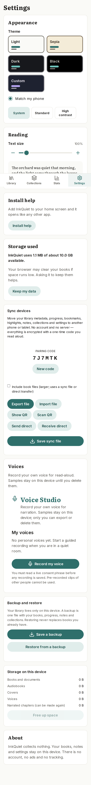

# Device sync (Settings → Sync devices)

Report for branch `feature/sync` (off `feature/integrate-2`).

## Commit

- **SHA:** `ac65a93` (full: `ac65a93…` on branch `feature/sync`)

## Bundle sizes (gzip, production build)

| Chunk | Size | Budget |
|---|---:|---:|
| Initial JS (first load) | 118.62 kB | 120 kB |
| `SyncSettingsPanel` (lazy) | 2.82 kB | 48 kB |
| `SyncWirelessPanel` (lazy, QR/WebRTC UI) | 2.71 kB | 48 kB |
| `render` (lazy, `qrcode`) | 10.02 kB | 48 kB |
| `sync.worker` | 44.99 kB | 55 kB |

Sync UI and QR libraries load only when Settings opens the Sync devices section (and wireless modes load `SyncWirelessPanel` + `qrcode`/`jsqr` on demand).

## Tests

| Suite | Result |
|---|---|
| Vitest (`npm test`) | 1781 passed |
| Playwright `tests/e2e/sync-devices.spec.ts` (chromium-mobile) | 1 passed |

## Screenshot

## What shipped

- Encrypted `.pnsync` export/import (optional full library with book files).
- Animated QR for metadata sync (chunked `PN1|…` frames).
- Optional WebRTC data channel with Google public STUN only; SDP exchanged via chunked QR (`PNO`/`PNA`).
- Merge: last-write-wins per record; highlight notes merged safely when the same highlight id differs.
- Pairing code shown on screen; AES-GCM + PBKDF2 (Web Crypto, no third-party crypto).

## New dependencies (see `docs/LICENSES.md`)

- `qrcode` (MIT)
- `jsqr` (Apache-2.0)
